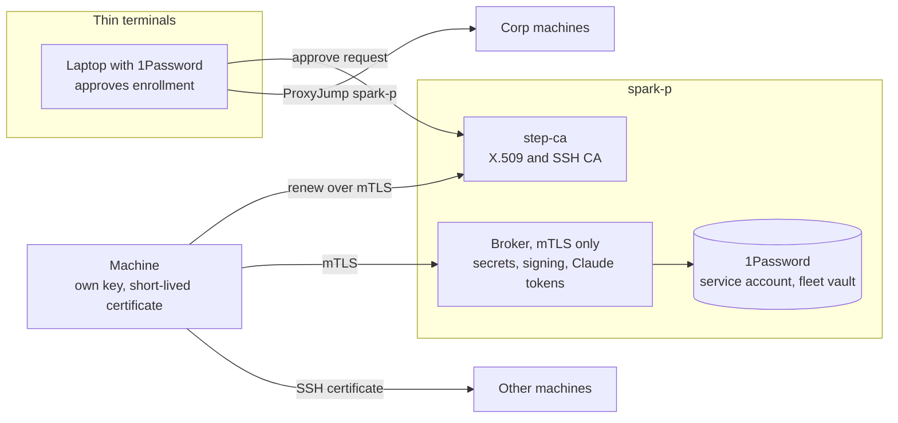

# Fleet identity, SSH, signing, and secrets

Date: 2026-10-13

This note records the target design for machine identity across the fleet. It does not implement the design. Chezmoi excludes `agent-docs/` from the target home directory.

## Requirements

- Laptops, the iPhone, and the iPad are thin terminals. They are usually not headless.
- Always-on machines do the work: public VMs, private servers (DGX Spark, DGX Station), Slurm login nodes, and Kubernetes clusters. These machines are usually headless.
- Corp machines are reachable through the jump host `spark-p`. `spark-p` is a member of the tailnet.
- Some machines keep a persistent home directory and shell, for example Slurm login nodes. Others are ephemeral, for example a container in a Kubernetes pod.
- SSH between machines must not need a password or a 1Password biometric approval for each connection.
- SSH to tailnet machines must use SSH keys for authentication, not the Tailscale browser login.
- Git commits must be signed without a person present.
- Secrets come from one central location. 1Password is the source of the secrets.
- Each machine gets its own client certificate. The certificate gives access to secrets, SSH, and Git signing. Revocation of the certificate removes the access of that machine.
- Claude sessions on remote machines get their login token from the central server, through a launcher.

## Decisions

| Topic | Decision |
|---|---|
| Central host | `spark-p` runs the certificate authority and the broker. It is on the tailnet and on the corp network. |
| Certificate authority | [step-ca](https://smallstep.com/docs/step-ca). It issues X.509 client certificates and SSH user and host certificates. It also does renewal and revocation. |
| Broker | A small service on `spark-p` that accepts only mTLS clients with certificates from the fleet CA. It reads 1Password through a service account. |
| Git signing | Remote signing. The signing key stays on the central host. A machine sends the data to sign to the broker over mTLS. |
| Tailscale SSH | Mixed. Machines with sshd turn off Tailscale SSH and use OpenSSH with certificates. Tagged ephemeral containers without sshd can keep Tailscale SSH with the `accept` action. |

## Design

### Enrollment and renewal

Each machine makes its own private key. The private key does not leave the machine. A person approves the first certificate request from a laptop with 1Password. After enrollment, the machine renews its certificate with its current certificate. A renewal timer runs as a systemd user unit, a launchd agent, or a loop in the container supervisor.

Short certificate lifetimes limit the access of a machine that stops renewal. The revocation list removes access before expiry.

`bb-worker-cert` already implements a request and approval exchange, and keeps the key in memory-backed storage. The enrollment command reuses that approach.

### SSH

The SSH user CA signs a user certificate for each machine. Servers trust the CA, not individual keys.

- On machines with sudo, sshd trusts the CA through `TrustedUserCAKeys`. The host CA signs the host key, and clients trust it through a `@cert-authority` line in `known_hosts`.
- On machines without sudo, for example Slurm login nodes, `~/.ssh/authorized_keys` trusts the CA through a `cert-authority,principals="..."` line.
- Corp machines use `ProxyJump spark-p`. Agent forwarding is not necessary.

Tailscale SSH authenticates with the tailnet identity, not with SSH keys. The browser login comes from the `check` action in the tailnet policy.

### Git signing

Git calls the program in `gpg.ssh.program` with the arguments of `ssh-keygen -Y sign`. On fleet machines, that program sends the data to the broker over mTLS and writes the signature that the broker returns. The broker signs with the signing key from 1Password. Signing requires a connection to the broker.

### Secrets

The broker resolves `op://` references for a machine according to a policy for the identity in the certificate. The service account reads only a dedicated fleet vault. `openv` uses `op` on primary machines and uses the broker on other machines.

### Claude tokens

`claude setup-token` makes a long-lived token for a Claude subscription. Claude Code reads that token from `CLAUDE_CODE_OAUTH_TOKEN`. Each token needs one browser login on a laptop. The tokens are kept in the fleet vault. The launcher gets a token from the broker and sets the variable only for the `claude` process.

## Changes to existing tools

- `provision-keys` copies one private key to each machine. Per-machine certificates replace that model.
- `private_dot_ssh/modify_private_config.tmpl` and `dot_gitconfig.tmpl` already include `~/.ssh/provisioned/`. Enrollment writes the local SSH and Git settings there.
- `git-signing-status` must report the remote signing state.

## Phases

1. This design note.
2. step-ca on `spark-p`. Chezmoi installs the `step` CLI and the enrollment and renewal commands.
3. SSH certificates, CA trust lines, `ProxyJump` blocks, and the Tailscale SSH setting.
4. The remote signer and the Git signing program.
5. The secrets broker and the broker backend for `openv`.
6. Claude token delivery through the launcher.

## Open questions

- Open question: what lifetimes do user, host, and client certificates get?
- Open question: what principals do SSH user certificates carry, and which hosts accept each principal?
- Open question: how do corp machines reach the CA and the broker on `spark-p`: over the corp network address or through a forwarded port?
- Open question: how many Claude tokens are necessary, for example one for each trust level? How is one token revoked?
- Open question: is `spark-p` an acceptable place for the CA keys, given that it is also the corp jump host? Where are the root CA key and its backup kept?
- Open question: how does step-ca on `spark-p` get the password for its intermediate key at startup without a person present?
