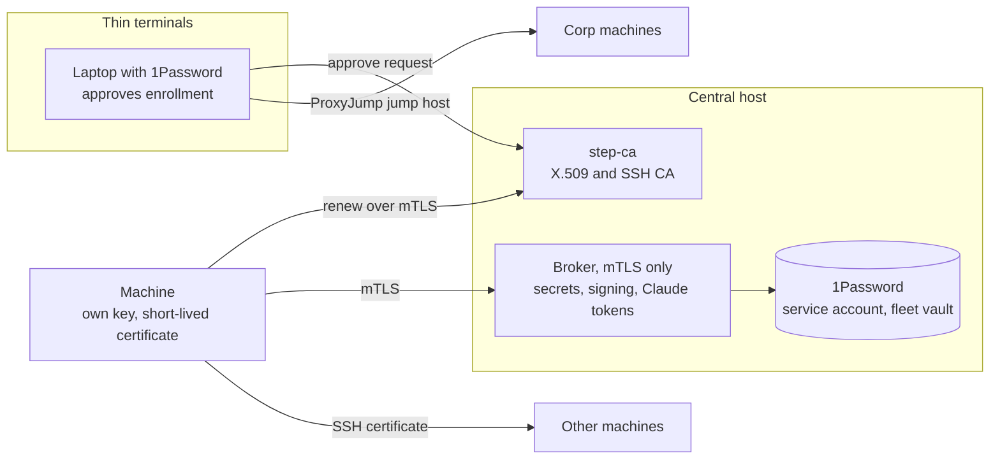

# Fleet identity, SSH, signing, and secrets

Date: 2026-10-13

This note records the target design for machine identity across the fleet. It does not implement the design. Chezmoi excludes `agent-docs/` from the target home directory.

## Requirements

- Laptops, the iPhone, and the iPad are thin terminals. They are usually not headless.
- Always-on machines do the work: public VMs, private servers (DGX Spark, DGX Station), Slurm login nodes, and Kubernetes clusters. These machines are usually headless.
- Corp machines are reachable through a jump host. The jump host is a member of the tailnet.
- Some machines keep a persistent home directory and shell, for example Slurm login nodes. Others are ephemeral, for example a container in a Kubernetes pod.
- SSH between machines must not need a password or a 1Password biometric approval for each connection.
- SSH to tailnet machines must use SSH keys for authentication, not the Tailscale browser login.
- Git commits must be signed without a person present.
- Secrets come from one central location. 1Password is the source of the secrets.
- Each machine gets its own client certificate. The certificate gives access to secrets, SSH, and Git signing. Revocation of the certificate removes the access of that machine.
- Claude sessions on remote machines get their login token from the central server, through a launcher.

## Decisions

| Topic | Decision |
|---|---|
| Central host | The corp jump host runs the certificate authority and the broker. It is on the tailnet and on the corp network. Superseded on 2026-10-14; see the addendum. |
| Certificate authority | [step-ca](https://smallstep.com/docs/step-ca). It issues X.509 client certificates and SSH user and host certificates. It also does renewal and revocation. |
| Broker | A small service on the central host that accepts only mTLS clients with certificates from the fleet CA. It reads 1Password through a service account. |
| Git signing | Remote signing. The signing key stays on the central host. A machine sends the data to sign to the broker over mTLS. |
| Tailscale SSH | Mixed. Machines with sshd turn off Tailscale SSH and use OpenSSH with certificates. Tagged ephemeral containers without sshd can keep Tailscale SSH with the `accept` action. |

## Design

### Enrollment and renewal

Each machine makes its own private key. The private key does not leave the machine. A person approves the first certificate request from a laptop with 1Password. After enrollment, the machine renews its certificate with its current certificate. A renewal timer runs as a systemd user unit, a launchd agent, or a loop in the container supervisor.

Short certificate lifetimes limit the access of a machine that stops renewal. The revocation list removes access before expiry.

`bb-worker-cert` already implements a request and approval exchange, and keeps the key in memory-backed storage. The enrollment command reuses that approach.

### SSH

The SSH user CA signs a user certificate for each machine. Servers trust the CA, not individual keys.

- On machines with sudo, sshd trusts the CA through `TrustedUserCAKeys`. The host CA signs the host key, and clients trust it through a `@cert-authority` line in `known_hosts`.
- On machines without sudo, for example Slurm login nodes, `~/.ssh/authorized_keys` trusts the CA through a `cert-authority,principals="..."` line.
- Corp machines use `ProxyJump` through the jump host. Agent forwarding is not necessary.

Tailscale SSH authenticates with the tailnet identity, not with SSH keys. The browser login comes from the `check` action in the tailnet policy.

### Git signing

Git calls the program in `gpg.ssh.program` with the arguments of `ssh-keygen -Y sign`. On fleet machines, that program sends the data to the broker over mTLS and writes the signature that the broker returns. The broker signs with the signing key from 1Password. Signing requires a connection to the broker.

### Secrets

The broker resolves `op://` references for a machine according to a policy for the identity in the certificate. The service account reads only a dedicated fleet vault. `openv` uses `op` on primary machines and uses the broker on other machines.

### Claude tokens

`claude setup-token` makes a long-lived token for a Claude subscription. Claude Code reads that token from `CLAUDE_CODE_OAUTH_TOKEN`. Each token needs one browser login on a laptop. The tokens are kept in the fleet vault. The launcher gets a token from the broker and sets the variable only for the `claude` process.

## Changes to existing tools

- `provision-keys` copies one private key to each machine. Per-machine certificates replace that model.
- `private_dot_ssh/modify_private_config.tmpl` and `dot_gitconfig.tmpl` already include `~/.ssh/provisioned/`. Enrollment writes the local SSH and Git settings there.
- `git-signing-status` must report the remote signing state.

## Phases

1. This design note.
2. step-ca on the central host. Chezmoi installs the `step` CLI and the enrollment and renewal commands.
3. SSH certificates, CA trust lines, `ProxyJump` blocks, and the Tailscale SSH setting.
4. The remote signer and the Git signing program.
5. The secrets broker and the broker backend for `openv`.
6. Claude token delivery through the launcher.

## Open questions

- Open question: what lifetimes do user, host, and client certificates get?
- Open question: what principals do SSH user certificates carry, and which hosts accept each principal?
- Open question: how do corp machines reach the CA and the broker: over the corp network address or through a forwarded port?
- Open question: how many Claude tokens are necessary, for example one for each trust level? How is one token revoked?
- Open question: is the corp jump host an acceptable place for the CA keys? Where are the root CA key and its backup kept?
- Open question: how does step-ca get the password for its intermediate key at startup without a person present?

## 2026-10-14 addendum: CA host and the `fleet` command

The CA does not run on the corp jump host. The jump host is shared corp infrastructure, so a compromise of it would expose the CA keys. The CA runs on a small cloud VM in a cloud account that the user owns. Corp machines have outbound internet access, so they reach the CA directly on TCP 443 with mTLS. The jump host is not in the CA path.

The intermediate key and the SSH user and host CA keys are cloud KMS keys. The VM can sign with the keys, but the keys cannot leave the KMS. This answers the startup password question: step-ca needs no key password. The root key and the enrollment provisioner key are only in 1Password. The project has a monthly spending cap that disables billing. The deployment values are in a private repository, not here.

Answers to the open questions:

- Client certificates last 24 hours. SSH user certificates last 16 hours. Host certificates cannot outlive the client certificate.
- SSH user certificates carry fixed principals from the CA template. A requested principal is ignored. Host certificate principals are the DNS names in the client certificate.
- Corp machines reach the CA over the internet.

The step-ca X5C provisioner does not check revocation. A revoked client certificate cannot renew, but it can get SSH certificates until it expires. The 24-hour client lifetime limits this gap.

`fleet` (`dot_local/bin/executable_fleet`) implements enrollment, renewal, SSH trust, and revocation. The README section "Fleet certificates" describes its use. Keys are files with mode `0600` in `~/.local/state/fleet`. They are not in memory-backed storage, because a reboot would then need a new token from a person, and always-on machines must renew without a person. This differs from `bb-worker-cert`.

Host certificates in `sshd` are not implemented. A host certificate cannot outlive the 24-hour client certificate, so `sshd` needs a daily renewal as root. Until then, `fleet` writes `StrictHostKeyChecking accept-new` for fleet aliases, tailnet addresses, and `*.ts.net` names (2026-10-14). WireGuard authenticates tailnet peers, so the first connection is not open to an attacker outside the tailnet.

## 2026-10-14 addendum: broker and admin certificates

The broker runs on the CA host. It is an mTLS service on TCP 8443. Its first endpoints are `/v1/whoami` and `/v1/machines`. `fleet list` uses the second one. The broker reads the step-ca log, because step-ca has no API that lists issued certificates. The broker refuses a certificate that is on the CA's CRL, so a revocation takes effect at the broker within one minute. The broker fails closed when the CRL is unavailable or out of date.

Admin rights come from a second JWK provisioner, `admin`. step-ca records the issuing provisioner in an extension of each certificate (OID `1.3.6.1.4.1.37476.9000.64.1`), and renewal keeps the extension. `fleet login` uses the admin provisioner. `enroll`, `invite`, and `enroll-remote` use the enroll provisioner. Each provisioner key is in its own 1Password item. A name allowlist was rejected because the holder of the enroll key chooses machine names. Tailscale capability grants were rejected for now because they tie admin calls to the tailnet.

## 2026-10-14 addendum: remote ssh-agent

The broker also serves the ssh-agent protocol on TCP 8444 with the same mTLS and CRL checks. The private keys are Cloud KMS keys (EC P-256), so no machine and no broker process holds the key material. The broker answers only the list and sign requests. A policy file names each key and marks keys for admin certificates only. This replaces the separate Git signing service of the original design: Git signs with `ssh-keygen -Y sign`, which uses the agent.

The first client is `socat`, which opens a new mTLS connection for each agent client. A measured `ssh-add -L` from a laptop took about 0.34 seconds and a signature about 0.5 seconds: a 70 ms round trip, an 80 ms handshake, 60 ms for the KMS signature, and process overhead. A persistent local agent can cache the key list and keep one connection, which leaves about one round trip and one KMS signature per signature. That agent is planned in Rust.

## Addendum 2026-10-14: the Rust agent

The Rust agent is `pylon agent`, in the private `agentic-control` workspace (`crates/pylon`). It keeps pooled mTLS connections to the broker, retries once on a new connection when a pooled one is dead, and caches the key list for 300 seconds. A keepalive refreshes the list every 120 seconds, below the broker's 300-second idle timeout. Four signatures from a laptop took 0.14 to 0.17 seconds, against 0.51 to 0.54 seconds through `socat`. `fleet agent` starts `pylon` when it is installed and `socat` otherwise. `pylon` has no release binaries yet, so each machine builds it with `cargo`.

## Addendum 2026-10-14: revocation check for X5C

This supersedes the revocation gap that line 117 describes. The broker now serves a step-ca authorizing webhook on loopback of the CA host. The X5C provisioner for SSH certificates calls it, and the broker refuses a revoked client certificate. A second X5C provisioner issues 1-hour client certificates from a current machine certificate. It is the first part of a two-certificate model: a long-lived machine credential that only gets short access certificates. step-ca reads `webhooks` from the top level of the provisioner `options`. Inside `options.x509`, step-ca ignores it without an error.

## Addendum 2026-10-14: secrets from the broker

The broker serves named secrets over the same mTLS port as the machine list. A policy on the CA host lists, for each secret, its source in a cloud secret store and the machine-name patterns that can read it. An unknown or forbidden name gives the same 404, so a machine cannot discover the other names. The broker reads the value on each request and logs only the name and the caller. The CA host's service account can read only the listed secrets.

`fleet secret get NAME` prints a value. `fleet secret env VAR=NAME -- CMD` runs a command with values in its environment. `fleet claude` is the launcher for remote Claude sessions: it sets `CLAUDE_CODE_OAUTH_TOKEN` from a secret that holds a token from `claude setup-token`. 1Password stays the place where a person keeps secrets. The cloud store is the copy that machines can reach without a person.

## Addendum 2026-10-14: machine classes

Fleet now does Git signing, GitHub SSH, and SSH between machines without 1Password. [machine-classes-and-fleet.md](machine-classes-and-fleet.md) is the plan to split `machine_class` into an install setting and a separate 1Password setting, and to give `openv` the broker backend that the "Secrets" section describes.

## Addendum 2026-10-15: 1Password as a broker source

A secret source in the broker policy can now be an `op://` reference as well as a Secret Manager version. The broker reads it with a read-only 1Password service account, which can read only a dedicated `Fleet` vault. The broker also refuses a source outside the vaults in its `--op-vaults` flag. This returns to the design in "Secrets" above: the broker resolves `op://` references, and the service account reads only a dedicated fleet vault. The 2026-10-14 addendum used Secret Manager so that no 1Password token is on ca-1. With this change, a token for one read-only vault is on ca-1, and 1Password stays the only store. Secret Manager sources still work. The plan for the rollout is in [machine-classes-and-fleet.md](machine-classes-and-fleet.md).

## Addendum 2026-10-15: pylon from the broker

`pylon` no longer needs `cargo` on each machine. The broker serves release binaries from the Cloud Storage bucket `ryanolson-fleet-ca-artifacts` at `/v1/artifacts/NAME/VERSION/TARGET` (fleet-config `0d81ae5`). `fleet install-pylon` downloads the build for the machine and checks a SHA-256 that `fleet` pins, so the bucket must be available but need not be trusted. Each machine can download 20 artifacts each hour, because egress costs count against the 10 USD cap that stops the CA. A separate 2 USD budget sends email and stops nothing. Pinned build: `0.1.0-4a1328e`, from the `pylon/renew` branch of agentic-control, for `darwin-arm64`, `linux-aarch64`, and `linux-x86_64`.

## Addendum 2026-10-21: every Fleet vault reference

The broker now serves any `op://` reference in a vault of `--op-vaults` (only `Fleet`) to every fleet machine, with no entry in `secrets.json` (fleet-config `ae76cc5`). Before, `GET /v1/secrets?ref=` returned 404 for a reference without an entry, so each new Fleet item needed a policy edit and a broker deploy, and a machine without a signed-in `op` (for example spark-p running `wcie-codex`) could not read the item until then. The `Fleet` vault holds only fleet secrets, and the service account can read only that vault, so an entry for each item added a step but no protection. An entry still applies to its exact reference: its machine patterns and `admin_only` still limit it. Ephemeral workers do not get this rule; their ticket must still name each secret. A reference to an item that does not exist now gives 503 (the `op read` fails), not 404.
