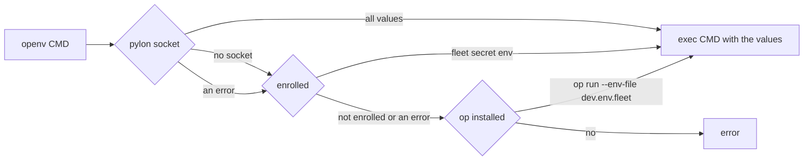

# One secrets file, the broker first, and a pylon cache

Date: 2026-10-15

Status: steps 1 and 2 done (fleet-config `0aaafe1`, dotfiles). Step 3 in progress.

## Goal

Every machine uses the same file, `~/.config/dynamo/dev.env.fleet`. `openv` gets each secret from the fleet broker first and uses `op` only when the broker path fails. `pylon` keeps the values in memory for a short time, so a command that uses `openv` does not make a request to the broker for each secret each time.

## The file

Each line is `VAR=op://VAULT/ITEM/[SECTION/]FIELD` and names an item in the `Fleet` vault:

```
HF_TOKEN=op://Fleet/HuggingFace/credential
NGC_API_KEY=op://Fleet/NGC NIM Operations PAT/credential
```

The file is a valid `op run --env-file` file, so the `op` path needs no second map. The broker policy uses the same references as its sources, so the broker path needs no second map either. The dotfiles repository is public, and it already lists `op://` references. A reference is not a secret.

chezmoi writes the file on every machine. `fleet_secrets` in `.chezmoidata/team.yaml` holds the references.

## The order in openv



- A command gets all of its values from one source, never a mix of broker and `op` values. pylon and the broker count as one source: pylon holds copies of broker values.
- `openv` calls `fleet secret get` once for each variable. `fleet` asks pylon first and the broker when pylon fails.
- `dev.env.op` stays for `openv-file` and for references outside `Fleet`. Open question: does any machine need a variable in `openv` that is not in `Fleet`? The local `credentials_*.yaml` overrides were not read.

## Broker: look up by reference

`GET /v1/secrets?ref=<URL-encoded op:// reference>` returns the secret whose policy source is that exact reference. The policy checks are the same as for `/v1/secrets/NAME`: machine patterns, `admin_only`, and 404 for an unknown or forbidden reference. Only `op://` sources can be looked up by reference. `fleet secret env VAR=op://...` uses this endpoint. `VAR=NAME` keeps working.

## pylon: the secrets socket

`pylon agent` gets two optional flags. When both are given, it also serves secrets:

- `--secrets-socket PATH`: a Unix socket, mode 0600. `fleet` uses `$XDG_RUNTIME_DIR/fleet-secrets.sock` on Linux and `~/.ssh/fleet/secrets.sock` otherwise.
- `--broker-url https://HOST:8443`: the broker HTTP API. pylon uses the same client certificate files as the agent and reads them again after a renewal.
- `--secrets-ttl SECONDS`: default 900.

The protocol is HTTP/1.1 on the socket. `curl --unix-socket` can call it, so the bash tools need no new client.

| Request | Answer |
|---|---|
| `GET /v1/secrets?ref=<URL-encoded reference>` | 200 with the raw value (`application/octet-stream`). The broker status for 404, 403, and 429. 503 when the broker cannot be reached. |
| `POST /v1/flush` | 200 with `{"flushed": N}`. Removes every value from the cache. |
| `GET /v1/status` | 200 with `{"entries": N, "ttl": S}`. No references and no values. |

Rules:

- pylon answers only a peer with the same user ID as pylon (`SO_PEERCRED` on Linux, `getpeereid` on macOS). Any process of that user can already read `node.key` and call the broker, so the socket adds no new access.
- Values stay in memory only, in buffers that are set to zero when they are removed (`zeroize`). pylon never writes a value to disk or to a log. Logs name the reference only.
- pylon caches only a 200. An error goes to the caller and is not cached.
- A flush makes the next request go to the broker. A rotation in 1Password reaches a machine after the broker cache (60 seconds) and the next pylon flush or expiry.

`fleet secret flush` sends `POST /v1/flush` to the local pylon.

## Flush on every machine

Today: an SSH loop that runs `fleet secret flush`. Later: an executor in agentic-control that runs the same command on every worker over NATS. The automatic `pylon` updates come from the same executors. Until then, `fleet install-pylon` runs by hand.

## Order of work

1. Broker: lookup by reference, with tests (fleet-config).
2. Dotfiles: `dev.env.fleet` with references on every machine, `fleet secret env VAR=op://...`, `fleet secret flush`, and the `openv` order, with tests.
3. pylon: the secrets socket, cache, flush, status, and peer check, with tests (agentic-control, stacked on `pylon/renew`). `fleet agent` passes the new flags when the installed pylon has them.
4. Release the new pylon through the artifacts bucket and pin it in `fleet`.
